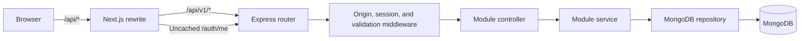

# Doctor Tracker backend

## Elevator pitch

The Doctor Tracker backend is a standalone Express 5 REST API for the secure administration of doctors, patients, and clinic activity. It owns Admin authentication, request validation, patient assignment rules, MongoDB persistence, indexed list queries, and dashboard aggregation. The separate Next.js frontend reaches it through a same-origin rewrite.

Companion repository [Doctor Tracker frontend](https://github.com/Mueem-Nahid/doctors-tracker-frontend).

## Responsibilities and API

- Admin login, current-session checks, logout, and session revocation.
- Doctor creation, listing, search, date/facet filtering, pagination, detail, and patient counts.
- Doctor-scoped patient list/create/delete operations.
- Global patient list/create/detail/edit/reassignment/delete operations.
- Dashboard summary with all-time totals, reporting-window metrics, chart datasets, and recent patients.
- Liveness/readiness endpoints and centralized request validation/error handling.

The browser-facing `/api/*` path is rewritten to Express `/api/v1/*` by Next.js. The REST contract documents request/response fields, query parameters, date semantics, and error codes: [API contract](docs/API_CONTRACT.md).

## Architecture



The API is a modular monolith. `auth`, `doctors`, `patients`, and `dashboard` own their routes and business logic. Controllers translate HTTP requests, services enforce rules and compose reads, and repositories own persistence and projections. Runtime-neutral DTOs and Zod schemas are shared from `packages/contracts`.

## Data and security

- MongoDB collections: `users`, `sessions`, `doctors`, and `patients`.
- Patients are stored separately from doctors and reference a doctor ObjectId. Reassignment updates the patient’s doctor; patient counts are derived from the patient collection.
- Passwords use Argon2id. Sessions use opaque random tokens, store only token digests, expire after 12 hours, and are issued in an HttpOnly, SameSite cookie.
- Protected endpoints require the Admin role. Mutations validate the configured browser origin, JSON request bodies are size-limited, and login attempts are rate-limited.
- Protected responses are marked private/no-store. Do not place patient data, passwords, cookies, or database credentials in logs or screenshots.

## Local setup

Use Node.js 24 LTS, npm, and a reachable MongoDB 7 instance or Atlas cluster. From this repository's root, install dependencies and copy the sample configuration.

```powershell
npm ci
Copy-Item .env.example .env
```

Set `MONGODB_URI` in `.env`. Set `PUBLIC_APP_ORIGIN` to the exact browser origin, and provide a unique `ADMIN_EMAIL`, `ADMIN_PASSWORD`, and `ADMIN_NAME` for the one-time provisioning step. The example file contains placeholders, not usable credentials.

Deploy the declared indexes, provision an Admin, and optionally seed synthetic data.

```powershell
npm run indexes:deploy
npm run admin:provision
npm run dashboard:seed
```

The dashboard seed is repeatable. It creates 500 marked demo doctors and 30,000 synthetic patients with uneven workloads and deterministic pseudorandom timestamps from January 1, 2025 through the time the seed runs. The first and last patient records anchor that date range. Every demo doctor receives at least 15 patients; larger workloads taper deterministically across the directory. On a subsequent run it removes only those demo doctors and their assigned patients before recreating the data.

To clear application data while preserving Admin accounts, run this destructive command with an explicit confirmation matching the database name in `MONGODB_URI`:

```powershell
npm run data:clear -- --confirm doctor_tracker
```

Replace `doctor_tracker` with the actual database name. The command deletes all doctors, patients, and sessions in that database, leaves user/Admin accounts intact, and refuses to run when `NODE_ENV=production`. Clearing sessions signs out all Admins. It does not run automatically during setup or seeding.

Start the API from this repository's root.

```powershell
npm run dev
```

The API listens on port `4000` by default. Start the Next.js app separately using the [frontend setup guide](https://github.com/Mueem-Nahid/doctors-tracker-frontend#local-setup).

## Configuration

See [backend/.env.example](.env.example) for the complete sample. The main settings are:

| Variable                                      | Purpose                                                                                   |
| --------------------------------------------- | ----------------------------------------------------------------------------------------- |
| `MONGODB_URI`                                 | MongoDB connection string.                                                                |
| `PORT`                                        | API listen port; defaults to `4000`.                                                      |
| `PUBLIC_APP_ORIGIN`                           | Exact allowed origin for browser mutations.                                               |
| `TRUST_PROXY_HOPS`                            | Trusted reverse-proxy hop count; set it for the deployment topology.                      |
| `NODE_ENV`                                    | Controls production cookie behavior.                                                      |
| `REPORTING_TIME_ZONE`                         | Reporting calendar for list date filters and dashboard buckets; defaults to `Asia/Dhaka`. |
| `ADMIN_EMAIL`, `ADMIN_PASSWORD`, `ADMIN_NAME` | Used by `admin:provision`; not read during login.                                         |

The frontend’s server-only `BACKEND_ORIGIN` must point to this API and must not be exposed as a `NEXT_PUBLIC_` variable. Do not commit `.env` files.

## Indexes and query measurement

Create the indexes declared by the Mongoose models with:

```powershell
npm run indexes:deploy
```

After loading the synthetic dataset, capture `explain("executionStats")` results and a dashboard summary latency sample:

```powershell
npm run query:measure
```

The output records dataset size, examined keys/documents, returned rows, blocking-sort presence, and `30d` dashboard summary latency. Measurements are environment- and dataset-dependent; no numbers are claimed here until captured against a reachable MongoDB instance. See [backend architecture](docs/ARCHITECTURE.md) for expected query shapes.

## Verification

From this repository's root, run the backend checks.

```powershell
npm run lint
npm run typecheck
npm run build
npm run format:check
```

The API workflow test requires `MONGODB_TEST_URI` pointing to a disposable database named exactly `doctor_tracker_test`. It drops that database before and after the run. The pagination validation tests also run without MongoDB.

```powershell
$env:MONGODB_TEST_URI = "mongodb://127.0.0.1:27017/doctor_tracker_test"
npm run test:integration
```

The API workflow covers authentication, duplicate and concurrent doctor creation, patient search and pagination, sorting doctors by patient count, scoped deletion, reassignment, dashboard totals, and session revocation.

## Health checks and deployment

- `GET /api/v1/health/live` reports that the process is running.
- `GET /api/v1/health/ready` returns readiness based on MongoDB connectivity.

Deploy this repository as an Express service with `npm run build` and `npm start`. Requests from browsers reach Express through the Next.js HTTPS origin. Configure `PUBLIC_APP_ORIGIN`, server-only `BACKEND_ORIGIN`, `TRUST_PROXY_HOPS`, and a least-privileged MongoDB account for the actual topology. Verify cookie set/forward/clear behavior, origin checks, no-store headers, rate limiting, and both health endpoints through the real ingress.

See the [frontend README](https://github.com/Mueem-Nahid/doctors-tracker-frontend) for the client setup and screenshots.
